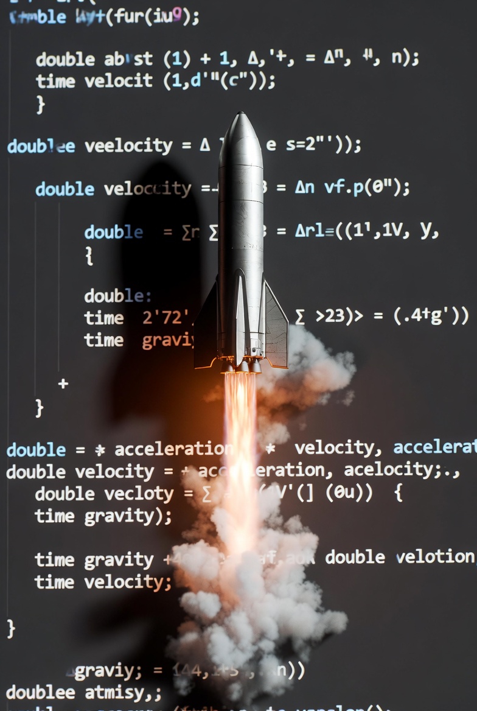
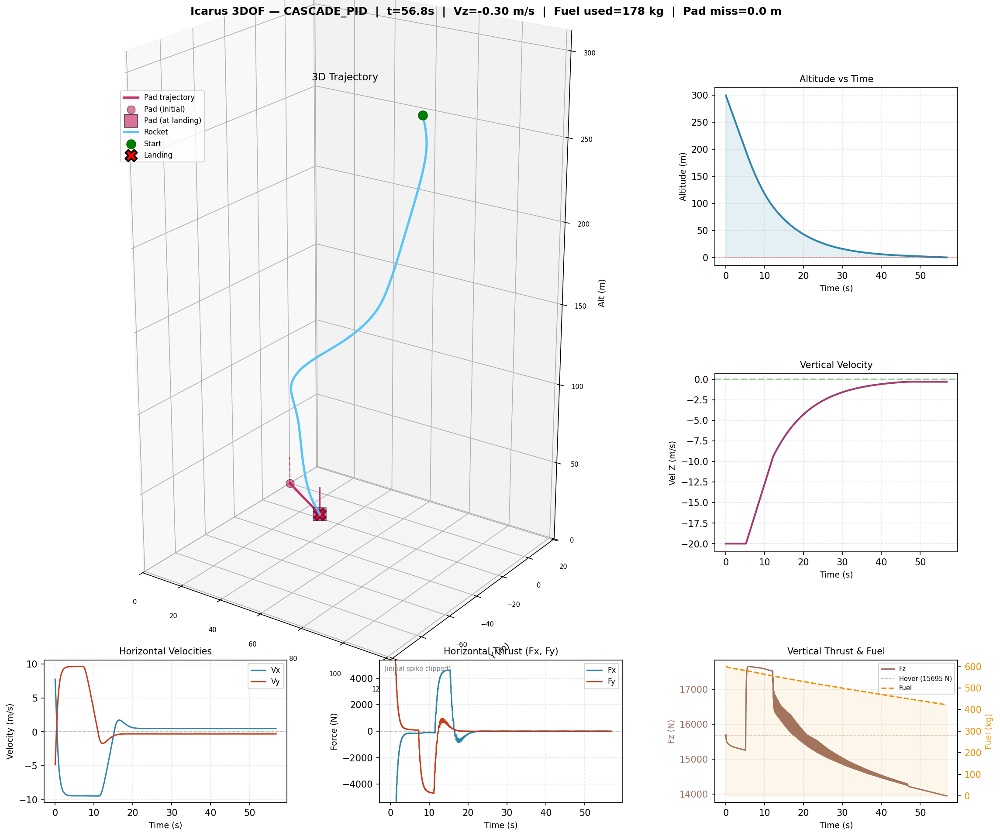
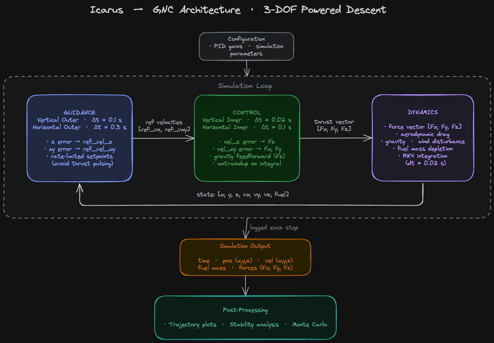

# Icarus

  

Icarus is a study of how a rocket comes down. The landing is the hard part: the vehicle is lightest when it has to be most precise, and the loop that holds it there is unstable if you stay too long.

Three pieces of that study live here.

**Icarus-S** ([sim/](sim/)) is the public site. A picture you can move, a chart of the same numbers, and a conversation that can move the picture or ask for another series. The first scene is one state and its rate.

**Icarus-I** ([rockets/](rockets/)) is the first airframe, a LOC IV in build for a Level 1 flight. The number belongs to the rocket. A later flight of this one stays Icarus-I. The next rocket built is Icarus-II.

**The landing** ([engine/](engine/)) is a C++ simulation through three finished phases: a vertical landing, a 3-DOF descent onto a moving pad in wind, and a stability analysis of that loop.

  

Phase 2. Cascade PID from 300 m, with wind and a pad that drifts. Thrust is a force vector. The tank gets lighter as it burns, so the same newton buys more acceleration near the ground. The rocket meets the pad.

  

Guidance turns position error into a reference velocity. Control turns velocity error into thrust. Dynamics integrates that force, with gravity, drag, and a mass that changes.
