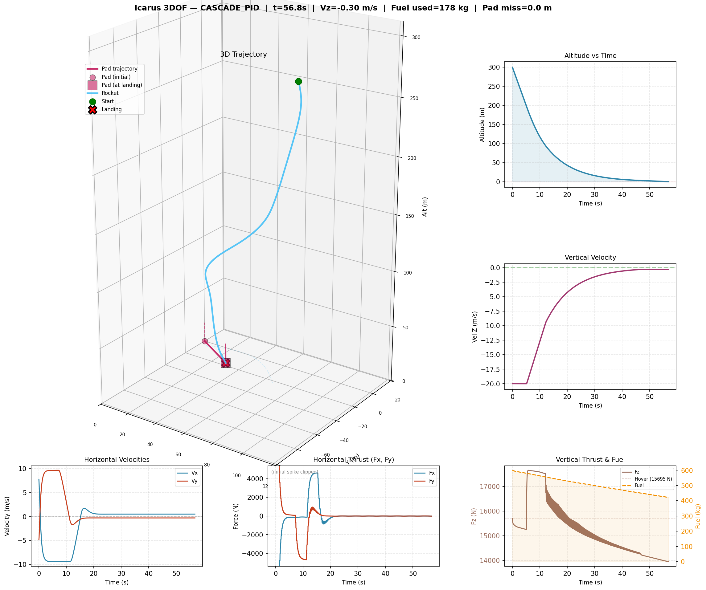

# The landing

A powered descent in C++, and the ship that climbs toward orbit and comes back through the air. The default plant is six degrees of freedom: position, velocity, a quaternion, body rates, and fuel. Thrust is a force through a gimbal. The three-degree-of-freedom point mass is still available when that path is off.

The first three phases are the vertical landing, the same loop in wind onto a moving pad, and the stability writeup of that loop.

| Phase | What it shows |
|---|---|
| 1 | A vertical landing. Cascade PID, one degree of freedom. |
| 2 | The same loop in three dimensions: wind, drag, and a pad that moves. |
| 3 | Why that loop can land a rocket it cannot hover. The hover is linearly unstable. Touchdown works because the rocket does not stay there. |

  

Phase 2, from 300 m. The outer loops command a reference velocity. The inner loops turn velocity error into thrust, with gravity feedforward on the vertical channel. Fuel mass drops along the way. The landing mark is the pad, not the point the pad started on.

The writeups are in [docs/](docs/): stability, mechanics, and the build.

Rocket Dynamics scenes on [icarus-arc.com](https://icarus-arc.com) keep their own clock in the browser, so the picture and the chart are the same buffer. On the Simulator, Earth opens on a recorded climb from booster separation, and Return plays a recorded entry from 120 km at 7.6 km/s. Landing and the Moon stream this plant. The page sends a case, and `IcarusStream` writes each sample as the flight runs. The listener still clamps a request into a hop, so the climb and the return stay recordings. `engine/listen/` is the HTTP listener in front of that binary. The public machine is the Fly app `icarus-arc-flight` in Dallas. It stops a few minutes after the last connection and starts on the next request. `make run` is still the Rerun landing on this computer. The flight image builds with Rerun off.
