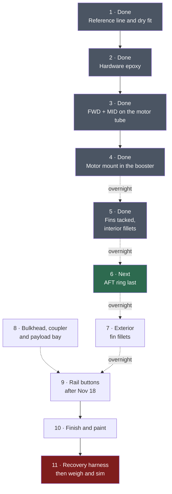
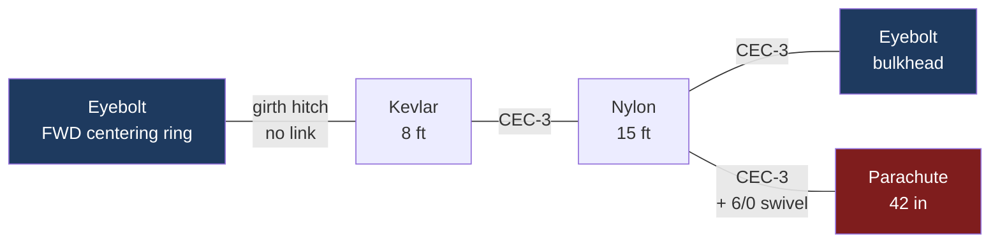

# LOC IV build guide

Working order of operations for **Icarus-I**, merged from the kit sheet and the R.E.A.R. build video.
The sheet and the video transcripts are not in this repo.

| Source | Short ref | Where |
|---|---|---|
| LOC instruction sheet, rev 12 May 2025 | **sheet §N** | not in this repo |
| R.E.A.R. build video, 3 parts | **P1/P2/P3 @mm:ss** | not in this repo |
| Parts and fit findings | **inventory** | `inventory.md`, photos in `photos/01-inventory/` |

Where the video and the sheet disagree, the reason is given. Follow the video for *technique*, the sheet for *dimensions*.

---

## Where the build stands

**As of 2026-10-18.** Sessions 1 through 5 are done. All three fins are tacked with wood glue. The interior epoxy fillets are in and curing. The AFT ring is still off. The cut ends of the booster, payload bay, and coupler are sealed with thin CA. The motor tube is not. The name on the paint will be **Icarus I**, in vinyl.

**Next:** leave those fillets overnight. Session 6 is the AFT ring.

**On the bench:** thin CA, medium or gel CA, nitrile gloves, electrical tape, plastic bonding primer, a respirator with organic-vapor cartridges, and nylon push rivets, 5 mm by 6.5 mm. Nose cone flash is trimmed and the cone is sanded. Primer waits for the colour coat.

**Still open, and not blocking Session 6:**

| Decision | Holds | Decide by |
|---|---|---|
| Buy gloss white. Tubes are fluorescent over that white. Fins and nose cone are gloss black, already bought. | Session 10 | Before spraying |
| Pad confirmation | Session 9 | The Nov 18 LUNAR meeting |

The Sept 16 meeting was cancelled. The membership meeting is now **Nov 18**. The buttons on hand are 1010, and that size stays. Nov 18 confirms that Snow Ranch has a 1010 rail, and whether an 8 ft rail is available. Do not drill the button holes until that night, because paint locks them in. Sessions 4 through 8 do not wait on the meeting.

Fin edges were rounded on 2026-10-11. OpenRocket has not been started. The Dec 5 flight is the maiden, so the Session 11 weigh-and-sim is the only check on the delay.

---

## The whole build at a glance

Epoxy cure is the pacing item, not work. Dashed arrows are waits.



Session 8 fits into any cure wait from Session 4 on. Fin edges are already rounded. The nose cone is sanded, and its primer waits for the colour coat.

> [!tip] Parallel work
> Every session with a dashed arrow leaves an evening. Use them for learning OpenRocket, and the payload bay once the bulkhead decision is made.

---

## Already bought

On the bench as of 2026-10-18.

| Item | Status | Why it was on the list |
|---|---|---|
| **Thin CA** | On hand. Ends sealed 2026-10-11. | Booster, payload bay, and coupler. Motor tube left bare. |
| **Medium or gel CA** | On hand | Tacks the fins in Session 5. Thin CA runs; this grabs. P2 @26:18. |
| **Nitrile gloves** | On hand | The polyethylene gloves tear and let epoxy through. |
| **Plastic bonding primer** | On hand | The nose cone is polypropylene. Nothing else holds a topcoat. P1 @03:16. |
| **Electrical tape** | On hand | Locks the parachute shroud-line gather. P3 @30:53. |
| **OV respirator** | On hand | Spraying. The mesh dust mask only covers sanding. |
| **Nylon push rivets, 5 mm by 6.5 mm** | On hand. 50-pack, bought 2026-10-18. | Three hold the coupler in the payload tube. Session 8. |

The bulkhead gets epoxied into the coupler. The coupler is held in the payload tube with three of these rivets, so it can come out later for an avionics bay. See [Session 8](#session-8-payload-bay). They do not block the AFT ring.

---

## Session 1: Reference line and dry fit

> [!note] Done as of 2026-10-11
> Reference line, dry fit, and the ring pencil marks are on the motor tube. Kept here so those marks can be rechecked if the Session 4 fin fit does not land.

**Needs:** pencil, steel ruler or machinist square, sandpaper. No glue.

### 1a. Strike the reference line

Measure between two fin slots on the booster, mark the centre, and draw a line the full length of the tube through that mark. Everything aft aligns to it.

> [!warning] A 4" tube will not sit in most door jambs
> The sheet suggests a door frame. P1 @45:32 points out that a 4" tube is too wide and too shallow for most of them. Use your machinist square or the 24" steel ruler laid along the tube, and sight down the fin slots to check you are straight.

### 1b. Dry fit, in order

**What a dry fit is for.** You assemble the whole rocket with no glue anywhere, purely to find the parts that do not fit while they are still fixable. The epoxy is BSI Slow-Cure 30 minute, which sounds generous until a ring jams halfway down a tube with epoxy on it and no way to get it off or on. Every problem found in this session is a five minute sanding job. The same problem found in session 3 is a ruined part.

Nothing here is glued. Nothing here is permanent except the two pencil marks in 1c.

**Lay out first, and keep parts identified.** The three centering rings are burned FWD, MID and AFT and they are *not* interchangeable once you start sanding, because you will sand each bore to its own fit. Keep each ring next to its label. Photo `09` shows the aft ring with its two factory T-nut holes; that is how you tell it apart if a label rubs off.

---

**1. Fit the three rings onto the motor tube.**

The motor tube is the 38 mm one. Try each ring on by hand first. They will not go, or they will go a quarter inch and stop, and that is normal and expected. Laser cutting leaves a layer of **carbonized wood** on the inside edge of the bore, so what you are removing is char, not structure (P1 @16:27).

Wrap **P80** around a dowel or a marker pen and run it around the *inside* of the ring, a few strokes, then test on the tube. Repeat. Sand the **ring bore, never the tube**: the tube's outside diameter is what every other part indexes to, and the rings are the cheap, replaceable side of the joint.

- **Too tight:** needs a tap from anything, or it goes on but you cannot get it off.
- **Right:** slides along the tube with firm thumb pressure, stays where you leave it, does not rock or cock sideways when you nudge the edge.
- **Too loose:** falls or slides under its own weight. You have gone too far. Not fatal, since epoxy fills a gap, but it makes the ring hard to hold square while it cures.

Test each ring from **both ends** of the tube and slide it the full length. A bore can be round and still bind on a spot further along.

> [!tip] Leave it a touch snug
> Step 2 sands the tube, which takes a hair off its diameter. A fit that is perfect now will be very slightly looser afterwards. Aim for the tight end of *right*.

**2. Scuff the entire motor tube.**

**P120**, held in your fingers and wrapped around the tube, not on the flat yellow block: the block is flat, the tube is 1.5" across, and a flat block on that much curvature cuts a flat spot into it.

The fin tabs bond directly to this tube, through the wall of the booster, and you cannot see from outside where they will land. So you kill the gloss **everywhere**, end to end and all the way around (P1 @15:15). This is a surface-prep job, not a dimensional one: you are creating tooth for the epoxy, not removing material.

Done when you can roll the tube under a light at a shallow angle and see no shine from any angle, only uniform matte. Missed patches, not understanding, are the failure mode. Wipe down with denatured alcohol afterwards so no dust is left in the future bond line.

**3. Chamfer the booster's inner lip.**

The booster is the 23" slotted tube. The cut end of a cardboard tube squashes very slightly inward, and that inward lip catches the edge of a centering ring as it tries to enter (P1 @27:02). It feels like the ring is too big when actually the tube mouth is too small by a few thousandths.

Press the inner edge *outward* all the way around with a thumbnail or the rounded handle of a screwdriver. You are burnishing, not sanding, and you want a barely visible flare. Do this on the aft end, which is the end the motor mount enters.

**4. Slide the motor mount assembly into the booster.**

With the three rings on the motor tube, slide the whole thing into the booster from the aft end. Do not glue and do not set final positions yet; this is a travel test.

Two things to confirm:

- It slides the full depth without a ring hanging up on the tube wall.
- **No ring ends up sitting across a fin slot.** The fin tabs need to pass through those slots and reach the motor tube, and a ring in the way blocks them. Sight down a slot from outside and you should see motor tube, not plywood edge, along the tab's run.

**5. Fins into the slots.**

> [!important] The full fin fit cannot happen this session
> The rings are not glued yet, so they slide and rotate the moment the motor mount goes into the booster and you cannot hold the geometry still enough to seat a fin. That is the sequence, not a mistake. The **real assembled fin check is at the top of [Session 4](#session-4-motor-mount-into-the-booster)**, after FWD and MID have cured onto the motor tube and before any epoxy is mixed for the booster. Do the two component-level checks below today and defer the rest.

**5a. Does the tab pass through the slot?** Booster alone, motor mount out. Push each fin tab through each slot from the outside. You are checking slot length and width only. This is what finds a slot that needs a file, and it needs no other parts.

If a fin binds, remove material a little at a time, testing constantly (P2 @26:45). Widen the *slot* if it is tight along its length; thin the *tab* if the tab is thick. A little side to side play is fine, since the fillets carry the load.

Try all three fins in all three slots, settle on a combination, and mark each fin and its slot in pencil so they return to the same place at glue-up.

**5b. Is the tab the right height?** "Bottoms out on the motor tube" is a measurement before it is an assembly:

```
radial gap = (booster ID  -  motor tube OD) / 2      compare against tab height
```

Measure all three numbers. Tab height should match the radial gap within about 1/32".

- **Tab slightly short:** fine. The internal fillet fills it and carries the load anyway.
- **Tab clearly taller than the gap:** the fin can never seat. Find this now, not with epoxy going off.

> [!tip] Masking tape collars
> If you want the assembled look anyway, wrap a few turns of masking tape around the motor tube hard against each face of a ring. The collar stops it sliding. Useful for the MID ring, since 1c sets its position with a fin. Peel the tape the same evening so adhesive does not set on a surface you just scuffed for bonding.

**6. Nose cone into the payload tube.**

The payload tube is the 11" one. The cone should seat with light friction and stay put when you hold the tube upside down, but come apart with a pull. No sanding expected here.

Same check for the coupler into the payload tube; inventory already found that snug and correct, so this is confirmation only.

### 1c. Set the two positions that cannot be changed later

```
   forward                     motor mount tube                        aft
      │                                                                 │
      ▼                                                                 ▼
    ┌───┐                    ┌───┐                                  ┌───┐
    │FWD│                    │MID│                                  │AFT│
  ══╧═══╧════════════════════╧═══╧══════════════════════════════════╧═══╧══
    ↑                          ↑                                        ↑
    │                          │                                        │
  1/4" of tube            set by sliding a FIN in                  1/8" of tube
  left exposed            until the tab touches it                 past the ring
  forward of ring         (sheet says ~5.5" from aft;              for the MR-1
                           the fin decides, not the tape)          Z-clips
```

**What you are producing.** Not an assembly. **Pencil marks on the motor tube**, one per ring, showing where each ring's faces land. Session 3 epoxies FWD and MID onto those marks with 30-minute epoxy and no chance to slide them afterwards, so the marks *are* the commitment. Draw them, walk away, come back and check them cold before session 3.

**Why the sheet's numbers are only a starting point.** The sheet gives MID at about 5.5" from the aft end. Use that to get the ring roughly there, then let the fin set the final position. Slot cutting has its own tolerance and the tab is what has to touch the ring (P1 @23:12, P2 @07:50).

**Marking square on a round tube.** Freehand pencil marks on a 1.5" tube wander. Wrap a strip of paper or masking tape around the tube and slide it until the two edges meet cleanly with no spiral. That edge is now perpendicular to the tube axis, and you trace along it.

---

**AFT first: it is the datum.** Every other position is measured from the aft end of the motor tube, so set this one before you touch the others.

Slide the AFT ring on until **1/8" of motor tube protrudes past its aft face**. That protrusion is what the MR-1 Z-clips clamp against (P1 @26:03, P2 @06:44). A quarter inch is the figure for the optional screw-on retainer, which you do not have, so 1/8" it is.

The video checks this by loading a real motor case and fitting a Z-clip to it. You have no case and are buying the motor at the field, so take the 1/8" and move on; P1 @26:32 says exactly that for builders without a case.

> [!warning] Clock the T-nut holes off the fin slots
> The AFT ring is factory-drilled with two T-nut holes 180° apart (photo `09`), but which way they point is yours to choose. Rotate the ring so **neither hole lines up with a fin slot** (sheet §4C). Factory drilling does not guarantee this. Mark the chosen rotation with a pencil tick across the ring edge and onto the tube so it goes back the same way.

**MID next, set by a fin.** Slide the MID ring to roughly 5.5" from the aft end, then put a fin tab into its slot and slide the ring until the **tab's forward end touches the ring's aft face**. That contact is the point: the fin then bonds to the ring as well as to the motor tube, which is why the MID ring sits at the forward edge of the fin slots rather than at a round number.

Mark the aft face position. Check it against a second fin and a second slot before you trust it.

**FWD last, and it is about fillet room.** The forward ring sits near the forward end of the motor tube but not flush with it: leave roughly **1/4" of tube exposed forward of the ring** so there is somewhere for an epoxy fillet to sit on that face (P1 @22:16, @29:47). Anywhere from 1/8" to 1/4" works. Flush does not, because the fillet then has nothing to grip and hangs off the end of the tube.

---

**Before you stop, sanity check the whole thing.** Slide the assembly into the booster with the rings on their marks (tape collars help here) and confirm:

- The MID ring sits at the **forward edge of the fin slots**, seen through the slot.
- Nothing else crosses a slot.
- The aft end of the motor tube sits where the AFT ring's 1/8" overhang can still work.

> [!note] No epoxy this session
> The cut ends of the booster, payload bay, and coupler were sealed with thin CA on 2026-10-11. The motor tube was left bare. Recheck the coupler in the payload bay, and in the top of the booster, once that glue is hard. A film left on the inside makes the fit tighter.

---

## Session 2: Hardware into the rings

> [!note] Done as of 2026-10-11
> T-nuts and both eyebolts are epoxied and cured.

**Needs:** epoxy, gloves, both eyebolts, T-nuts, Z-clips.

Three small jobs, one batch of epoxy.

1. **Press the two T-nuts into the AFT ring** so the teeth are fully seated. Hammer, pliers, or a vice. Epoxy the *outer flange only*, keeping it off the threads (sheet §1B to §1D, P1 @12:48).
2. **Eyebolt into the FWD centering ring.** Nut, washer, through the hole, washer, nut. Epoxy everything: threads, both faces of the ring, inside the hole. P1 @19:57 does this while the assembly is loose so epoxy reaches the whole joint. **Keep the eyebolt eye parallel to the ring edge** so the harness runs straight.
3. **Eyebolt into the bulkhead plate**, same method, with the larger fender washers that came bagged with it (P2 @37:41).

> [!tip] Practise the fillet where nobody will see it
> Pull a nitrile glove tight, wet the fingertip with isopropyl, and smooth the epoxy fillet with your finger. The alcohol stops it sticking. This is the single best technique in the videos (P1 @31:55) and the fin fillets are where it shows. Learn it here, on a fillet buried inside the rocket.

---

## Session 3: FWD and MID rings onto the motor tube

> [!note] Done as of 2026-10-18
> FWD was epoxied 2026-10-11. MID was epoxied and is cured. The AFT ring is still off. The aft face of the MID ring stays bare.

Epoxy **only these two**. The AFT ring is deliberately left off.

Apply the epoxy as a bead ahead of the ring, then slide the ring forward *through* it with a twist so it forms its own fillet (P2 @08:50). Check square from two directions.

> [!warning] Do not fillet the aft face of the MID ring
> The fin tab corners land right there and a fillet stops them seating flush against the body tube. Leave it bare; it gets filled from the aft end in Session 5 (P2 @10:10).

---

## Session 4: Motor mount into the booster

> [!note] Done as of 2026-10-18
> Dry fit first, then the motor mount was epoxied into the booster the same day. The bead on the inside wall was placed by hand. Fins and the AFT ring were dry-fitted after the mount was in, and that fit was good. The AFT ring is still off.

> [!important] Dry, before any epoxy: the real fin fit check
> Done 2026-10-18, before the epoxy. This was the first moment the geometry was fixed, since FWD and MID had cured onto the motor tube. Session 1 could only check the slots and the tab height in isolation ([1b step 5](#1b-dry-fit-in-order)).
>
> The motor mount went into the booster dry, and all three fins seated. Each tab reached the motor tube, with the root edge flush against the booster.

The bead goes on in one pass, deep inside the tube, because the gap between the FWD and MID rings is too short for two stages (P2 @16:04).

1. Mark your stick at **10.5" (26 cm)** from the end, the point just aft of where the FWD ring will finally sit.
2. Mix a generous batch of the 30-minute epoxy. Long working time is the whole point here; you will be repositioning.
3. Load a blob on the stick, insert to your mark, and paint it round the inside wall. Repeat until used up.
4. Slide the motor mount in, twisting as it goes, until the MID ring appears **at the forward edge of the fin slots**.
5. **Dry fit a fin immediately** to confirm the tab still meets the MID ring, and check the aft overhang is still 1/8" all the way round. Adjust while the epoxy is soft.
6. Rotate the whole assembly to even out the internal fillet the ring pushed forward (P2 @22:08).

> [!danger] Keep epoxy out of the fin slots
> Wipe any that reaches them with alcohol on a tissue before it sets. A fin that cannot seat is a much worse problem than a thin fillet.

---

## Session 5: Fins, then interior fillets

> [!note] Done as of 2026-10-18
> All three fins are tacked with wood glue on the tab, where it meets the motor tube. The interior fillets are in: fin tab to motor tube, fin tab to the inside wall of the booster, and the aft face of the MID ring. The AFT ring is still off. Leave the fillets overnight before Session 6.

### 5a. Tack the fins

Run a bead of **medium/gel CA** along the tab edge that meets the motor tube, push the fin home, pull upward on the tube for contact, and hold it perpendicular while it grabs (P2 @26:18). This is not structural. It stops the fin drifting while you fillet.

Check perpendicular with the machinist square, sighting from behind the fin.

### 5b. Interior fillets: why the AFT ring is still off

With the aft end open you can reach in and fillet joints the printed sequence seals away forever (P2 @11:08):

- fin tab ↔ motor tube
- fin tab ↔ body tube inner wall
- aft face of the MID ring

This is the biggest single improvement over the sheet's order, and it is free. A 4" airframe is wide enough to get a hand and a stick inside.

Keep epoxy off the aft 1/8" of motor tube and the tube's inner edge, because the AFT ring still has to slide past.

---

## Session 6: AFT ring goes on last

Bead epoxy round the motor tube, seat the ring, fillet the outside face, smooth with the alcohol-and-glove trick.

**Clock it so the retainer screw is not directly over a fin** (P2 @31:54), or you cannot get a screwdriver on it.

---

## Session 7: Exterior fin fillets

Use **five-minute epoxy in small batches**, one fillet at a time, so it cannot run (P3 @13:13). Both sides of one fin, then move on.

Thin fillets over thick: they add far less mass for very nearly the same strength (P3 @14:08). Mass matters here: it feeds directly into your delay calculation.

Two ways to shape them:

- **Tape dams.** Mark rules along fin and tube, tape outside the lines, apply, pull the tape while wet, cure, sand (sheet, LOC PRO tip). Your blue 2090 is right for this.
- **Gloved finger and alcohol.** Faster, no masking, and by now you have practised it.

---

## Session 8: Payload bay

Fits into any cure wait.

**Mark the coupler at 4"**, its halfway point. Sand and lightly bevel the bulkhead edge until it drops into the coupler cleanly (P2 @36:43), then epoxy it in **recessed about 1/8"** from the coupler edge so there is room for a fillet. Give the exposed face a skim coat of 30-minute epoxy, since it takes the brunt of the ejection charge (P2 @43:43).

The coupler is not glued into the payload tube. Three reusable plastic rivets hold it at the 4" mark, so the whole coupler can come out later and an avionics bay can go in its place (P3 @01:00). The half that slides into the booster stays a friction fit. No rivets and no glue there. That is the joint that separates at ejection.

> [!note] Decided 2026-10-18: rivet the coupler, glue the bulkhead
> The rivets are on the bench: nylon push rivets, 5 mm by 6.5 mm, bought 2026-10-18. Three go through the payload tube and the coupler, about 3 cm up from the payload's edge, equally spaced. The nose cone does not get rivets. Tape holds the nose for the cert flight.
>
> The bulkhead is still epoxied into the coupler. The rivets do not replace that glue. The eyebolt is already in the bulkhead.

### Nose cone prep, any time

Flash is trimmed and the cone is sanded, as of 2026-10-11. Before the colour coat, shoot **plastic bonding primer**, then the Stops Rust gloss black (7779830, bought 2026-10-11). The primer is what the black sticks to. Nothing else will hold on this plastic. Leave the moulded eyelet alone (P2 @01:52). It carries no load, since the harness anchors to the bulkhead.

---

## Session 9: Rail buttons

> [!warning] Do not drill these until Nov 18
> The Sept 16 meeting was cancelled. Nov 18 confirms that Snow Ranch has a 1010 rail, and whether an 8 ft rail is available. The buttons on hand are 1010, and that size stays. Paint locks the holes, so the drill waits on the meeting. Sessions 4 through 8 do not.

Two buttons, on the reference line from Session 1, **before paint**.

The sheet's method: drill a small hole at the **FWD and AFT centering ring** positions, drop epoxy in the hole, drive the screw. Both are known structure, so no backer is needed. Trim the mould flash off the buttons first (P3 @17:29).

```
   nose ──────────────────────────────────────────────── tail
        │◄── 4" ──►│                                         │
        │  coupler │                                         │
        └──────────┘                                         │
                        ▲                              ▲
                        │                              │
                  FWD ring position              AFT ring position
                  (well clear of the             (at the very base)
                   coupler, good)
```

> [!warning] Nothing may protrude into the coupler zone
> P3 @21:18 hits this: a screw or nut poking into the tube anywhere the coupler and recovery gear live will snag shroud lines during ejection. The sheet's ring positions avoid it because the FWD ring sits far below the coupler. If you ever move a button upward, use a T-nut so nothing stands proud inside.

Take the buttons off before painting and refit afterward (P3 @25:04).

**Check your bag:** P3 @19:57 reports both wood screws *and* machine screws with nuts in the kit. Your photo `28` shows two wood screws. Confirm whether machine screws are also in there, since the ring method wants the wood screws anyway.

---

## Session 10: Finish

1. **Done 2026-10-11.** Cut ends of the booster, payload bay, and coupler are sealed with thin CA. Leave the motor tube bare: the aft ring still has to slide on, the motor has to slide in, and epoxy has to stick to that cardboard.
2. Filler primer on the booster, the payload bay, and the fins. Sand back. Repeat until the spirals and the wood grain are gone. Keep it off the nose cone and off the outside of the coupler.
3. Plastic bonding primer on the nose cone, then Stops Rust gloss black. Same black on the fins, over the filler primer.
4. On the booster and payload bay: gloss white, then the fluorescent orange already on hand. The fluorescent has to sit on white, not on the grey primer.
5. Clear coat over the decal.

---

## Session 11: Recovery harness, then weigh

### The chain



**Girth hitch, not a knot:** feed the sewn loop through the eyebolt, pass the far end through that loop, cinch down (P3 @26:30). No knot anywhere in the Kevlar, since a knot costs roughly half its strength.

You can do all of this **after** the motor mount is installed. A 4" tube is wide enough to get a hand down to the eyebolt, which is a real advantage of this kit and means the harness stays serviceable (P3 @23:32).

**Do not epoxy the shock cord attachment** (P3 @36:08). Keeping it changeable is the point.

### Parachute

Gather the shroud lines so all are the same length, feed them through the swivel, pass the swivel through the gathered loop and pull taut. **Wrap electrical tape just above the gather** so it cannot slip. A slipped gather means uneven lines, which makes the chute spin or drift (P3 @30:53).

> [!note] The 1/4" quick link choice is independently confirmed
> P3 @33:43 finds a 1/8" link physically will not pass a sewn loop, and calls for 3/16" or 1/4". Your CEC-3 is 1/4" and the fit is already tested against the actual cord.

### Then the part that matters most

**Weigh the finished airframe and find the CG.** Put both into OpenRocket with the H100W-14A loaded and confirm:

| Check | Target |
|---|---|
| Stability margin | 1.0 – 2.0 calibers |
| Rail exit velocity | above ~45 ft/s (ask for the 8 ft rail) |
| Descent rate | 15 – 20 ft/s on the 42" chute |
| **Optimum delay** | **drives how many seconds come off the 14 s delay** |

The delay is irreversible and you get one motor. This is why the finished weigh-in is not optional.

---

## Where this guide departs from the printed sheet

| Sheet says | This guide does | Why |
|---|---|---|
| Build the full motor mount, then install | Install with the AFT ring off, fit it last | Gives access to fillet fin tabs against the body tube interior (P2 @11:08) |
| Epoxy the rings, then insert | Bead epoxy inside the tube first, slide through it | The gap between the FWD and MID rings is too short for a second bead (P2 @16:04) |
| MID ring ~5.5" from aft | Position it with a fin as the gauge | The fin tab has to touch it; the measurement is a starting point |
| Door frame for the reference line | Machinist square or steel ruler | A 4" tube does not fit most door jambs (P1 @45:32) |
| Knot the nylon to the eyebolt | Girth-hitch a Kevlar leader, quick link to the nylon | Nylon against ejection gas is a known failure; knots halve Kevlar strength |
| Launch lug wording in §11 | Rail buttons | Legacy text; the parts list and §10 are correct |
